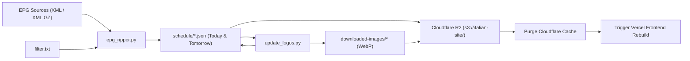

# Italian TV EPG Schedule Extractor & Cloudflare R2 Sync

Automated pipeline to scrape Electronic Program Guide (EPG) schedules for Italian TV channels, download and optimize show logos to WebP format, and sync everything directly to Cloudflare R2 with automatic CDN cache purging and Vercel frontend rebuild triggers.

## Architecture & Workflow



1. **Scraping (`epg_ripper.py`)**:
   - Downloads XMLTV data (supports raw `.xml` and compressed `.xml.gz`).
   - Filters channels based on [`filter.txt`](filter.txt).
   - Converts UTC broadcast times to Italian local time (`Europe/Rome`).
   - Filters schedules for **Today** and **Tomorrow**.
   - Outputs minified per-channel JSON files in `schedule/` and a consolidated `all-channel.json` master file.
   - Logs details to `scrape.log`.

2. **Logo Optimization (`update_logos.py`)**:
   - Concurrently downloads show banners/logos using 32 worker threads.
   - Converts images to WebP format (`WEBP_QUALITY = 80`).
   - Saves images categorized into `downloaded-images/<channel-folder>/<show-slug>.webp`.
   - Reuses existing images between individual channel schedules and the master `all-channel.json`.
   - Rewrites image URLs in the JSON files to point to the Cloudflare CDN (`https://cdn.tv-programma.it/...`).
   - Preserves minified JSON formatting by default to minimize bandwidth.

3. **CI/CD Automation (`.github/workflows/merge-workflow.yml`)**:
   - Runs on GitHub Actions daily at **23:30 UTC** (00:30 CET / 01:30 CEST).
   - Can also be triggered manually via `workflow_dispatch`.
   - Syncs schedules and WebP images to Cloudflare R2 bucket (`s3://italian-site/`).
   - Purges Cloudflare edge cache (`/purge_cache`).
   - Fired deploy hook triggers Vercel to rebuild the frontend.

---

## Configuration

### 1. Channels (`filter.txt`)

Configure channels in [`filter.txt`](filter.txt) using the `channel_id, channel_name` format:

```txt
# Format: channel_id, channel_name
Sky.Crime.it, Sky Crime
Sky.Investigation.it, Sky Investigation
20.it, 20
Rai.1.HD..101.it, Rai 1 HD  101
TV8.HD.it, TV8 HD
cielo.it, cielo
```

- Lines starting with `#` are treated as comments.
- Channel IDs must match the `id` attributes in the EPG XMLTV source.

### 2. EPG Sources (`epg_ripper.py`)

Add or update EPG XML/GZ feed URLs in the `EPG_URLS` list inside [`epg_ripper.py`](epg_ripper.py):

```python
EPG_URLS = [
    "https://epgshare01.online/epgshare01/epg_ripper_IT1.xml.gz",
    # Add more URLs if needed
]
```

### 3. GitHub Secrets

Ensure the following repository secrets are configured in **Settings → Secrets and variables → Actions**:

| Secret Name | Description |
| --- | --- |
| `R2_ACCESS_KEY_ID` | Cloudflare R2 S3 API access key ID |
| `R2_SECRET_ACCESS_KEY` | Cloudflare R2 S3 API secret access key |
| `CF_ZONE_ID` | Cloudflare Zone ID for cache purging |
| `CF_API_TOKEN` | Cloudflare API Token with Cache Purge permissions |

---

## Output Data Structure

### Individual Channel Schedule (`schedule/<Channel-Slug>.json`)

Contains schedule for Today and Tomorrow:

```json
{
  "channel_name": "Sky Crime",
  "days": [
    {
      "date": "2026-10-15",
      "programs": [
        {
          "name": "Il crimine tra noi",
          "start": "00:00",
          "end": "00:05",
          "logo": "https://cdn.tv-programma.it/wp-content/uploads/downloaded-images/Sky-Crime/il-crimine-tra-noi.webp",
          "episode": "S1 E25",
          "category": "Mondo e Tendenze"
        }
      ]
    }
  ]
}
```

### Master Schedule (`schedule/all-channel.json`)

Contains all filtered channels with Today's programs in a single file:

```json
[
  {
    "channel_name": "Sky Crime",
    "programs": [
      {
        "name": "Il crimine tra noi",
        "start": "00:00",
        "end": "00:05",
        "logo": "https://cdn.tv-programma.it/wp-content/uploads/downloaded-images/Sky-Crime/il-crimine-tra-noi.webp",
        "episode": "S1 E25",
        "category": "Mondo e Tendenze"
      }
    ]
  }
]
```

---

## Local Development & Testing

### Installation

```bash
# Clone the repository
git clone https://github.com/rishipandey6565/italian-guide.git
cd italian-guide

# Install dependencies
pip install -r requirements.txt
```

### Run the Scraper

```bash
# Step 1: Scrape EPG XML and generate schedules
python epg_ripper.py

# Step 2: Download logos and convert to WebP
python update_logos.py
```

Optional flags for `update_logos.py`:
- `--workers 16`: Adjust the number of concurrent download threads (default: 32).
- `--pretty`: Format the output JSON with indentation instead of minification.
- `--base-url <url>`: Override the CDN base URL.

---

## License

MIT License.
